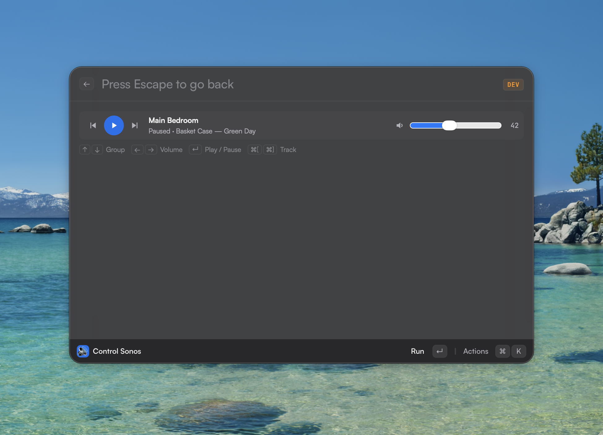

# Control Sonos for Asyar

Control your [Sonos](https://www.sonos.com/) speakers from the [Asyar](https://github.com/Xoshbin/asyar) launcher: a
control center with every group, what it plays, play/pause, track buttons and a volume slider, plus play/pause and track
commands for global hotkeys.

> **Requires an Asyar build with the `network:lan` permission** from
> [Xoshbin/asyar#879](https://github.com/Xoshbin/asyar/pull/879) (tested at `05916c0`), which is not in a release yet. The
> released launcher refuses every request to the speaker. Until then the extension is not in the Asyar Store; to try it,
> build it as described in [CONTRIBUTING.md](CONTRIBUTING.md).

## Setup

1. Make sure this computer is on the same network as your Sonos system.
2. Open **Sonos Control Center** in Asyar and accept the permissions it asks for.
3. Press **Add Speaker…** and choose your speaker in the row marked `SONOS` (or `ZonePlayer`), on port **1400**. Not
   listed? Use **Manual IP & port** with its IP address (Sonos app: **Settings → System → About My System**, or your
   router's list of devices) and port 1400.
4. Your groups appear. A dimmed group is led by a speaker that is not allowed yet: press **Allow…** on it.

The extension can reach only the speakers you allow. They are listed, and can be removed, in Asyar Settings (**⌘,** /
**Ctrl+,**) → **Extensions** → **Control Sonos** → **Local network devices**.

## Commands

| Command | What it does |
| --- | --- |
| **Sonos Control Center** | Every group with what it plays, with play/pause, track buttons and a volume slider |
| **Sonos Play / Pause** | Pauses the group if it is playing, otherwise plays |
| **Sonos Next Track** | Skips to the next track; a paused group starts playing first |
| **Sonos Previous Track** | Goes back a track; a paused group starts playing first. Sonos does not allow this on a radio station |

The last three are meant for global hotkeys: select one, press **⌘K** (**Ctrl+K**) and choose **Assign Shortcut**. They
control the group you last used in the Control Center (marked **Hotkeys** there) and show the result as a short message.
On Linux under Wayland, global shortcuts do not fire: bind a desktop shortcut to
`asyar://extensions/io.github.xoac.sonos/play-pause` (or `next-track`, `previous-track`) instead.

Keys in the Control Center:

| Key | Action |
| --- | --- |
| **↑** / **↓** | Select a group |
| **←** / **→** | Volume down / up by 5 (by 1 with **Shift**) |
| **Enter** / **Space** | Play / pause |
| **⌘[** / **⌘]** (**Ctrl+[** / **Ctrl+]**) | Previous / next track |

Not included: a menu-bar item, mute, per-room volume inside a group, album art, queue and favorites.

## Permissions

| Permission | Why |
| --- | --- |
| `network` | Sends the requests to the speakers through Asyar |
| `network:lan` | Reaches the speakers you allow and asks you to allow one. It declares no hosts of its own, so nothing else is reachable |
| `preferences:write` | Saves the group the hotkey commands control |

The extension does not run programs or use the clipboard, the filesystem or the internet.

## Legal

This is an unofficial community project and is **not affiliated with, endorsed by or sponsored by Sonos, Inc.** "Sonos" is
a trademark of its owner.

The behaviour follows the Raycast [Sonos extension](https://github.com/raycast/extensions/tree/main/extensions/sonos)
(MIT, by AntonNiklasson and contributors), which was used as a reference. No code was copied.

Licensed under the [MIT License](LICENSE).
